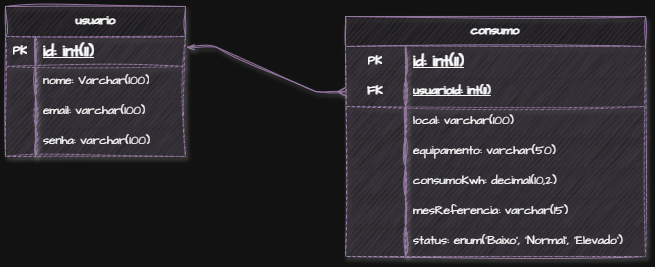
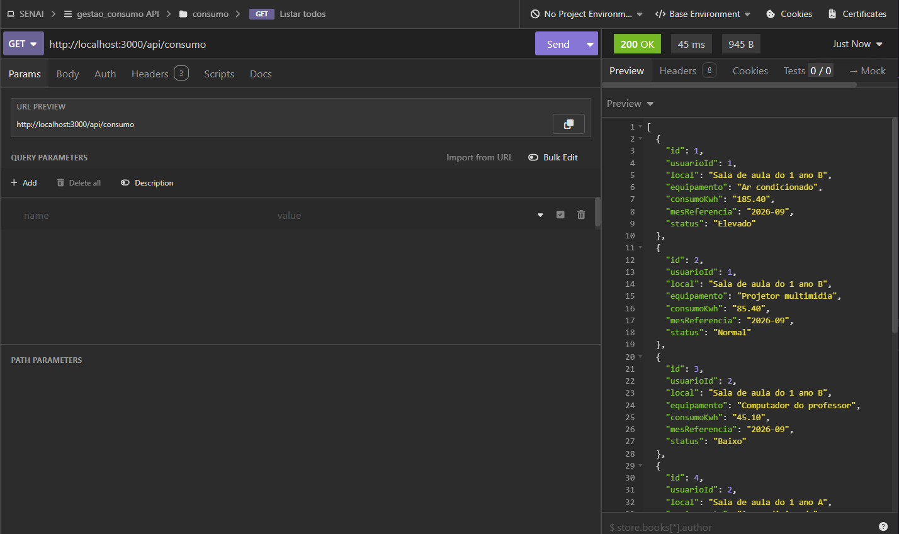
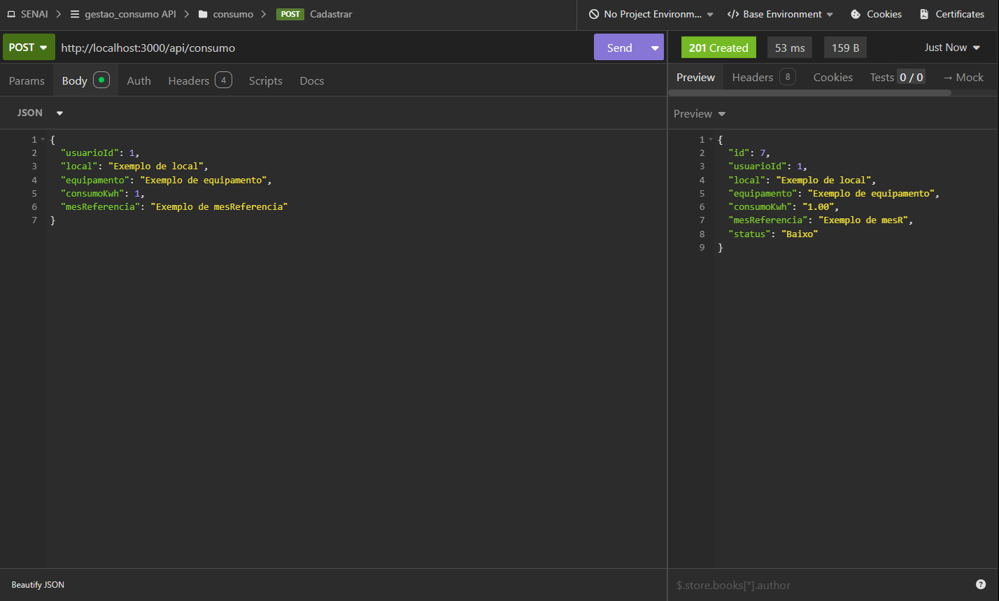
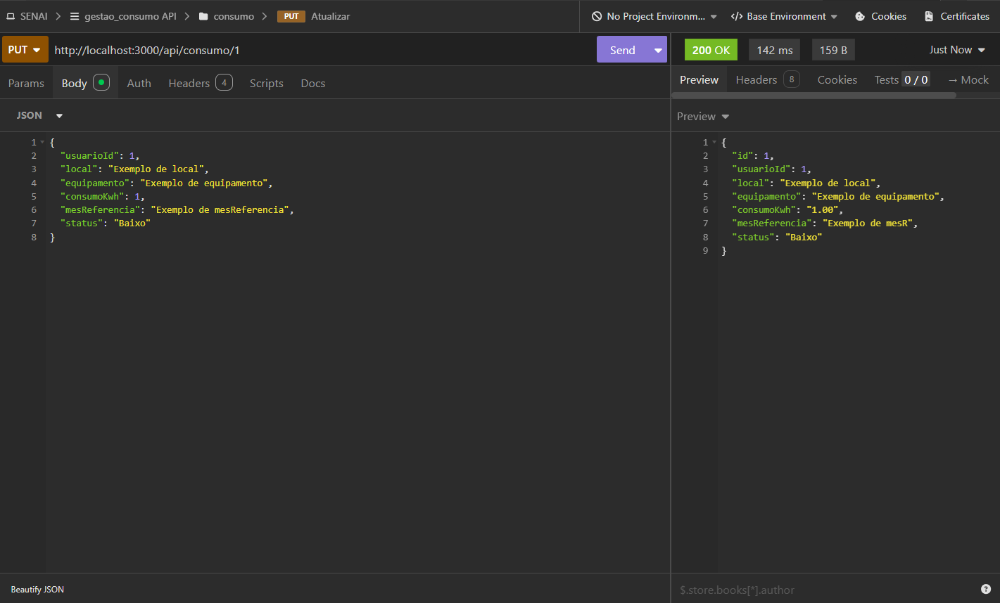
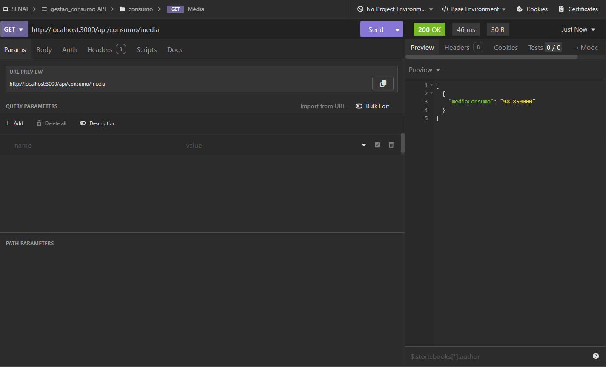
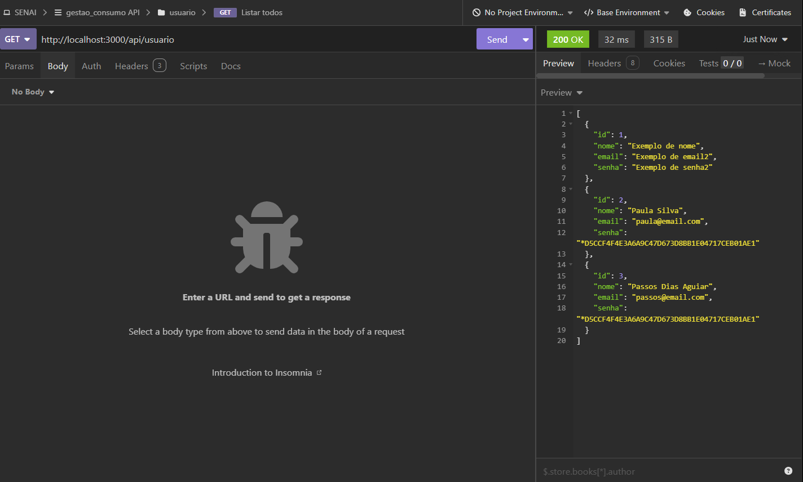
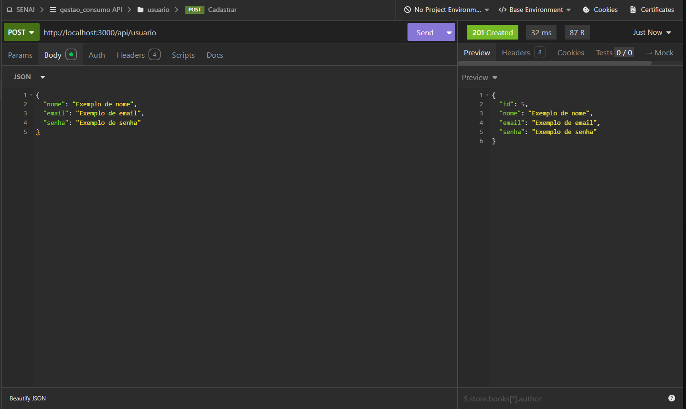
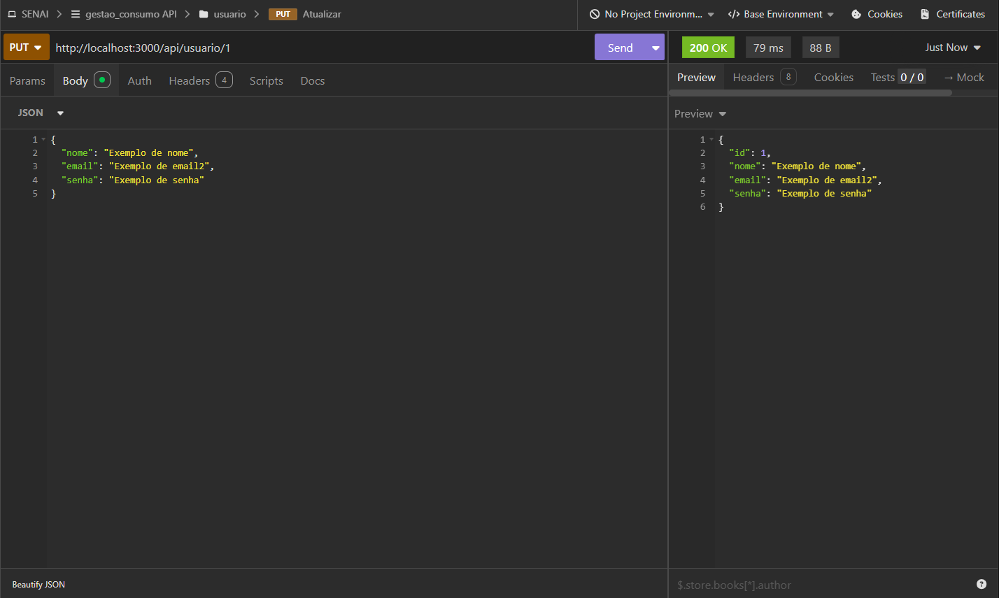
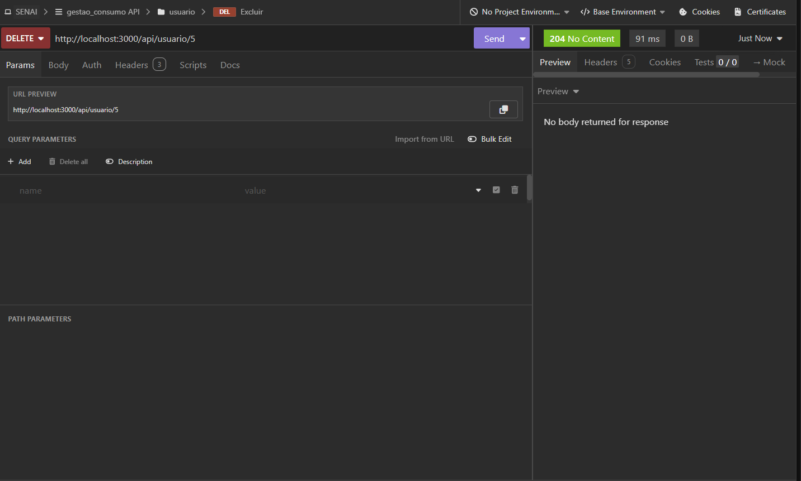
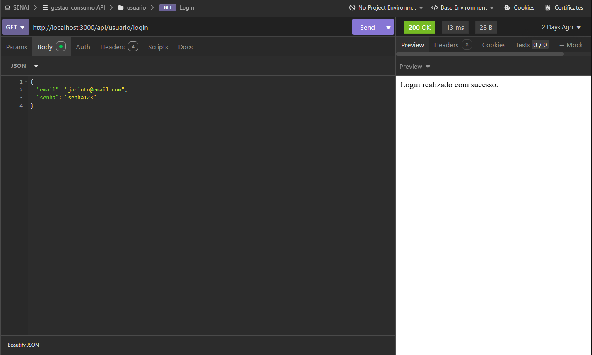

# Gestão de Consumo de Energia

## Descrição

API REST para gerenciamento de consumo de energia por local e equipamento. O sistema permite registrar o consumo em kWh, identificar o mês de referência e classificar o consumo como baixo, normal ou elevado.

A API oferece operações de cadastro, consulta, atualização e exclusão de registros de consumo, além de uma rota para calcular a média geral de consumo. Também possui operações de gerenciamento e login de usuários.

## Diagrama de Classes



## Tecnologias

- Node.js
- JavaScript (CommonJS)
- Express 5
- MySQL
- mysql2
- CORS
- Insomnia (testes da API)

## Passo a passo para testar

### 1. Pré-requisitos

Instale o Node.js e o MySQL Server. Tenha também o Insomnia ou Postman.

### 2. Configurar o banco de dados

1. Abra o MySQL Workbench ou outro cliente MySQL.
2. Execute o script `db/schema.sql`.
3. O script cria o banco `gestao_consumo`, as tabelas `usuario` e `consumo` e insere dados para teste.

### 3. Instalar dependências

No terminal, entre na pasta `ex3` e execute:

```bash
npm install
```

### 4. Iniciar o servidor

```bash
npm run dev
```

O servidor utiliza a porta `3000`:

```text
http://localhost:3000
```

### 5. Importar as requisições no Insomnia

O projeto disponibiliza o arquivo `insomnia-crud.json`. No Insomnia, selecione a opção de importar e escolha esse arquivo.

As rotas também podem ser testadas manualmente:

| Método | Endpoint | Descrição |
|---|---|---|
| GET | `/` | Verifica se o back-end está respondendo |
| GET | `/api/usuario/` | Lista usuários |
| POST | `/api/usuario/` | Cadastra usuário |
| PUT | `/api/usuario/:id` | Atualiza usuário |
| DELETE | `/api/usuario/:id` | Exclui usuário |
| GET | `/api/usuario/login` | Rota de login definida no projeto |
| GET | `/api/consumo/` | Lista registros de consumo |
| POST | `/api/consumo/` | Cadastra consumo |
| PUT | `/api/consumo/:id` | Atualiza consumo |
| DELETE | `/api/consumo/:id` | Exclui consumo |
| GET | `/api/consumo/media` | Retorna a média geral de consumo em kWh |

Exemplo de JSON para cadastrar um consumo:

```json
{
  "usuarioId": 1,
  "local": "Sala de aula",
  "equipamento": "Ar condicionado",
  "consumoKwh": 150.5,
  "mesReferencia": "2026-10",
  "status": "Normal"
}
```

Os valores aceitos para `status` são `Baixo`, `Normal` e `Elevado`.

> Observação: a rota de login está registrada como `GET` e o controller lê os dados de `req.body`. Para testá-la, confira o comportamento do cliente HTTP utilizado ao enviar corpo em uma requisição GET.

## Prints dos testes — Insomnia/Postman

As capturas abaixo foram encontradas na pasta `docs` do projeto.

### Consumo

| Operação | Captura |
|---|---|
| GET — listar consumos |  |
| POST — cadastrar consumo |  |
| PUT — atualizar consumo |  |
| DELETE — excluir consumo |  |
| Média de consumo |  |

### Usuários

| Operação | Captura |
|---|---|
| GET — listar usuários |  |
| POST — cadastrar usuário |  |
| PUT — atualizar usuário |  |
| DELETE — excluir usuário |  |
| Login |  |
